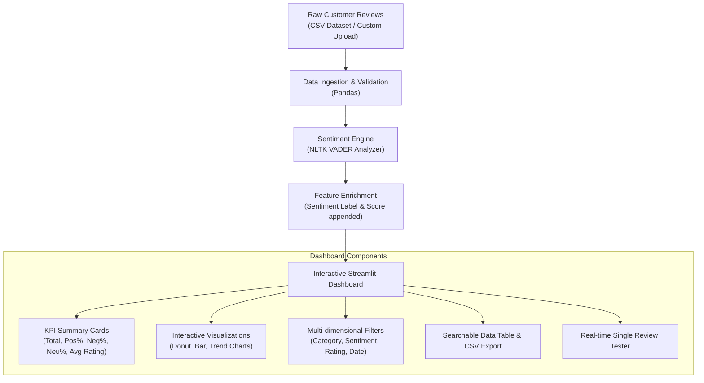

# 📊 Customer Sentiment Analysis Dashboard

An end-to-end, lightweight, and beginner-friendly **Customer Sentiment Analysis Dashboard** built for college internship projects. It extracts actionable insights from customer feedback by categorizing reviews into **Positive**, **Negative**, and **Neutral** sentiments using rule-based Natural Language Processing (NLP).

---

## 🎯 Project Objectives

1. **Automated Feedback Classification**: Automatically evaluate customer reviews and compute continuous sentiment polarity scores without relying on complex deep learning models or paid APIs.
2. **Interactive Visual Analytics**: Deliver clear key performance indicator (KPI) metrics, distribution charts, rating comparisons, and category trends via an intuitive web dashboard.
3. **Flexible Data Ingestion**: Provide out-of-the-box support for a realistic preloaded dataset (~350 reviews) while enabling users to upload and instantly analyze custom CSV files.
4. **Actionable Business Insights**: Enable product and customer success teams to filter reviews by category, rating, and date to pinpoint defects and highlight product strengths.

---

## 🏗️ System Architecture & Workflow



---

## 🛠️ Technology Stack

| Component | Library / Tool | Rationale for College Internship |
| :--- | :--- | :--- |
| **Core Language** | Python 3.9+ | Standard language for data science and AI. |
| **Data Manipulation** | Pandas & NumPy | High-performance tabular data wrangling and aggregation. |
| **Sentiment Analysis** | NLTK (VADER) | Specialized lexicon-based NLP for product reviews; fast, deterministic, and requires no GPU or model training. |
| **Web Dashboard** | Streamlit | Rapid UI development in pure Python with clean responsive components. |
| **Visualizations** | Plotly Express | Interactive, publication-ready charts (donut, grouped bars, trendlines). |

> [!NOTE]
> **Why No Deep Learning / BERT?**
> Complex transformer models (e.g., BERT, RoBERTa) and heavy deep learning frameworks (TensorFlow, PyTorch) require significant disk space (several gigabytes), long download times, and GPU hardware. VADER delivers rapid, accurate sentiment extraction for short product reviews within milliseconds on any standard laptop without external dependencies.

---

## 📂 Project Structure

```
customer-sentiment-dashboard/
│
├── app.py                     # Main Streamlit web application & UI
├── sentiment_analysis.py       # Core NLP sentiment analysis logic (NLTK VADER)
├── data/
│   └── customer_reviews.csv    # Sample dataset containing 350 realistic customer reviews
├── requirements.txt           # Python dependencies
└── README.md                  # Comprehensive documentation and setup guide
```

---

## ⚙️ Installation & Running Locally

### Step 1: Prerequisites
Ensure you have **Python 3.9 or higher** installed. Verify by running:
```bash
python --version
```

### Step 2: Clone or Navigate to the Project Folder
```bash
cd customer-sentiment-dashboard
```

### Step 3: Create and Activate a Virtual Environment (Recommended)
- **Windows (Command Prompt / PowerShell)**:
  ```powershell
  python -m venv venv
  venv\Scripts\activate
  ```
- **macOS / Linux**:
  ```bash
  python3 -m venv venv
  source venv/bin/activate
  ```

### Step 4: Install Dependencies
```bash
pip install -r requirements.txt
```

### Step 5: Launch the Dashboard
```bash
streamlit run app.py
```
After executing the command, Streamlit will automatically open the dashboard in your default web browser at `http://localhost:8501`.

---

## 🧠 How Sentiment Analysis Works

This project uses **VADER** (*Valence Aware Dictionary and sEntiment Reasoner*), a gold-standard rule-based model from the **NLTK** library.

### 1. Lexicon Matching
VADER maps words, idioms, and punctuation to human-validated valence scores between `-4.0` (extremely negative) and `+4.0` (extremely positive). For example:
- *"great"* = `+3.1`
- *"terrible"* = `-3.4`
- *"okay"* = `+0.9`

### 2. Heuristic Rules
VADER handles nuances in customer feedback:
- **Punctuation**: Exclamation marks amplify sentiment (*"Great!"* vs *"Great!!!"*).
- **Capitalization**: All-caps words intensify valence (*"GREAT"* has higher positive valence than *"great"*).
- **Degree Modifiers**: Intensifiers (*"extremely good"*) increase valence; downtoners (*"slightly good"*) decrease it.
- **Negation Handling**: Reverses sentiment polarity (*"not good"* is classified as negative).
- **Contrastive Conjunctions**: Shifts weight to the clause following conjunctions like *"but"* or *"however"* (*"Good design, but terrible battery life"* focuses on the battery issue).

### 3. The Compound Score Formula
The total valence is normalized between `-1.0` and `+1.0`:

$$Compound = \frac{x}{\sqrt{x^2 + \alpha}}$$

*(where $x$ is the sum of valence scores and $\alpha \approx 15$ is a normalization constant)*

### 4. Classification Thresholds
- **Positive**: $\text{Compound Score} \ge 0.05$
- **Neutral**: $-0.05 < \text{Compound Score} < 0.05$
- **Negative**: $\text{Compound Score} \le -0.05$

---

## 🖥️ Dashboard Components Breakdown

1. **Dashboard Overview (KPI Metric Cards)**:
   - **Total Reviews**: Real-time count of reviews meeting active filter criteria.
   - **Positive Reviews**: Count and percentage of positive feedback.
   - **Neutral Reviews**: Count and percentage of indifferent feedback.
   - **Negative Reviews**: Count and percentage of critical feedback.
   - **Average Rating**: Average 5-star customer rating.

2. **Sentiment Distribution (Donut Chart)**:
   - Visualizes overall proportion of positive, neutral, and negative feedback.
   - Color-coded: Green (Positive), Amber (Neutral), Red (Negative).

3. **Reviews by Rating (Bar Chart)**:
   - Shows the frequency of reviews across 1-star to 5-star ratings.

4. **Sentiment by Product Category (Grouped Bar Chart)**:
   - Compares customer reception across product lines (e.g., Electronics, Fashion, Home & Kitchen).

5. **Weekly Sentiment Trends (Line Chart)**:
   - Tracks review volume and sentiment fluctuations over time to identify seasonal patterns or product batch releases.

6. **Interactive Sidebar Filters**:
   - Product category selection
   - Sentiment classification filter
   - Star rating filter
   - Date range picker

7. **Searchable Review Table & CSV Export**:
   - Includes real-time keyword search (e.g., searching "battery" filters the table instantly).
   - Single-click download of filtered, sentiment-tagged data as a clean CSV file.

8. **Live Single Review Tester**:
   - Allows users or viva examiners to type arbitrary sentences into an input field and inspect the model's instant prediction and raw compound score.

---

## 📊 Sample Findings for Internship Report

The included sample dataset of 350 reviews demonstrates realistic customer behavior:

- **Overall Sentiment Distribution**:
  - **Positive**: 52.0% (182 reviews) — Customer praise centered on build quality, battery longevity, and comfortable apparel fit.
  - **Neutral**: 22.0% (77 reviews) — Customers noting products performed adequately for their price bracket.
  - **Negative**: 26.0% (91 reviews) — Primarily driven by product defects (e.g., zipper issues, Bluetooth drops, overheating).
- **Average Customer Rating**: ~3.42 out of 5.0 stars.
- **Category Observations**:
  - *Home & Kitchen* and *Electronics* exhibited the highest polarized feedback (clusters of 5-star and 1-star reviews).
  - *Fashion* and *Beauty & Personal Care* demonstrated consistent neutral-to-positive ratings.
